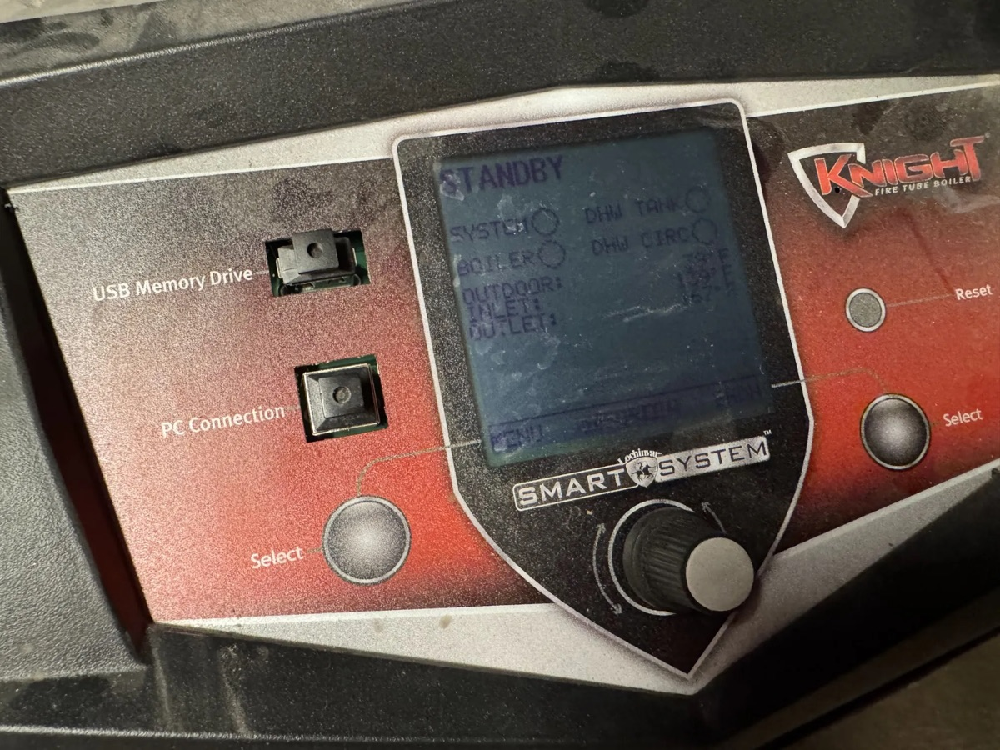

# lochinvar-native-modbus

See what your Lochinvar boiler is doing, right in Home Assistant. No add-on board needed.



Many Lochinvar boilers have a **PC Connection** USB port next to the display. Lochinvar's own service
software uses it. This project plugs into that port and reads the boiler's live data: temperatures,
flame signal, firing rate, status and lifetime counters. It sends them to Home Assistant over MQTT
or the ESPHome API, and the sensors show up on their own.

It is **read-only**. It can't change a setting or turn anything on or off.

> **This is not an official Lochinvar project.** Lochinvar did not make it and does not support it.
> We worked out the data by watching a real boiler and comparing it to the boiler's own screen.
> Use it at your own risk.

## Will it work on my boiler?

Look at your boiler's display. If it looks like the photo above, it probably works. You want:

- a large screen with a dial and two **Select** buttons, branded **SMART SYSTEM**,
- a square USB port labeled **PC Connection** (not the flat **USB Memory Drive** slot).

We have tested a **Knight Fire Tube** (KHB). Other boilers with this same display, like the Knight XL
and Armor, should work but are not tested yet. Older 2-line text displays and the Crest's touchscreen
won't work. See [Which boilers this works on](#which-boilers-this-works-on) for the full list.

## Pick a way to run it

Both ways give you the same sensors.

| | ESPHome package | Docker container |
|---|---|---|
| **Runs on** | A small, low-cost ESP32-S3 board | A Linux computer near the boiler, like a Raspberry Pi |
| **Talks to Home Assistant by** | Wi-Fi, with the ESPHome API or MQTT | Your network, with MQTT |
| **Good if** | You use ESPHome, or run Home Assistant OS | You already have a small server by the boiler |
| **Extra work** | One solder blob on the board | None |
| **Set it up** | [esphome/README.md](esphome/README.md) | [mqtt/README.md](mqtt/README.md) |

```
Boiler's PC Connection port --USB cable--> ESP32-S3 or Docker host --> Home Assistant
```

## What you need

- A boiler with the SMART SYSTEM display and a **PC Connection** port (see above).
- A USB cable. The boiler end is USB-B, the square kind on a printer cable. The other end must fit
  your ESP32 board or computer.
- An ESP32-S3 board, or a computer that runs Docker.
- Home Assistant. For MQTT you also need a broker, such as the Mosquitto add-on.

## What you get

All of these show up in Home Assistant under one device.

| Group | Entities |
|---|---|
| **Temperatures** | Outlet, Inlet, Exhaust and Outdoor Temperature (°F), Delta T (outlet minus inlet), and Target Temperature (what the boiler aims for during a call for heat) |
| **Burner** | Firing Rate (%), Flame Signal (µA), Flame Present, Fan Speed (rpm), Boiler Pump Output (%) |
| **Status** | Boiler Status: Standby, Demand, Demand held off, Prepurge, Ignition, Running, Post-purge, Pump delay, Anti-cycle or Link lost. Also Heat Demand, Burner Request and Anti-Cycle on their own. |
| **Settings** (read every 5 min) | SH1, SH2, SH3 and DHW Setpoint, High Limit Auto Reset and Manual Reset, and SH1 Reset Target (the heating set point after outdoor reset) |
| **Counters** (read every 5 min) | Power On Hours, SH Run Time, SH Cycles, Ignitions, Ignition Attempts, Failed Ignitions |
| **Health** | Outlet and Flue Sensor Difference (each sensor has two parts, and the boiler faults if they disagree), Boiler Link OK, Controller Online, and a count of link restarts |

Live values update every 5 seconds. A few raw values that we haven't figured out yet are hidden by
default. You can turn them on if you want to help map them.

### Ideas for using it

- **Short cycling:** count burns per hour with Boiler Status. Ours fired 21 times in 5 hours one night.
- **Failed ignitions:** alert when Failed Ignitions goes up. Don't alert on the total. Ours already
  read 109 when we started.
- **Calling but not heating:** alert when Heat Demand is on and Flame Present stays off for 15+
  minutes. Up to about 11 minutes is normal.
- **Sensor trouble:** alert when Outlet or Flue Sensor Difference climbs above a few degrees.
  Normal is under 1 °F. This can warn you before the boiler locks out.
- **Graphs:** firing rate against outdoor temperature shows how your outdoor reset curve works.

## It only reads. It never writes.

A boiler is a gas appliance, so this matters. Modbus has commands that read values and commands that
write them. This project only ever sends the read command (function 03).

- The ESPHome package has no switches, buttons, number boxes or other controls.
- The Docker container builds its own Modbus messages, and the only kind it can build is a read.
- Automatic checks run on every change. They fail if anything that could write to the boiler is added.

The boiler's display and buttons keep working as normal while the bridge is plugged in.

## Limits and known problems

- **No control.** You can't change set points or turn the boiler on or off. If you need that, see
  [Not the MODB-I-O board](#not-the-modb-i-o-board).
- **No lockout codes yet.** Our boiler hasn't locked out, so we don't know how lockouts look. A
  lockout should show as "Unknown (n)" in Boiler Status. Please open an issue if you see one.
- **The USB link sometimes drops.** On the ESP32, it stayed up through 24 burns in a row, then dropped
  once in the middle of a burn. On a Mac, it dropped at almost every ignition. We think electrical
  noise from the burner is the cause. When it drops, readings show as unavailable and Boiler Status
  reads "Link lost". After 3 minutes, the ESP restarts itself, or the container reopens the port.
  If that doesn't bring it back, unplug the USB cable and plug it back in.
- **The display is about 10 seconds behind.** When you compare the two while the burner is changing,
  expect small differences.
- **Some values are educated guesses.** The [register map](registers/controller.yaml) marks every value
  as known, a guess, or unknown. Guesses stay hidden unless noted.
- **A controller update could break it.** Lochinvar doesn't document this port, so new controller
  software could move things around.

## Not the MODB-I-O board

Lochinvar sells an add-on board called MODB-I-O. It has its own documented register list. This
project does **not** use that board, and their registers don't match. If you have a MODB-I-O board, see
[cwm12345/lochinvar-modbus](https://github.com/cwm12345/lochinvar-modbus).

| | MODB-I-O board | This project |
|---|---|---|
| Cost | You buy the board and wire it in | Free. A USB cable into the display |
| Registers | Documented by Lochinvar | Worked out by us. A few are still guesses |
| Data | A short summary | Much more: flame signal, burner stage, fan, pump, counters |
| Control | Can turn the boiler on or off and change the set point | Read-only. It can't change anything |
| Fault codes | Has status and lockout codes | Lockout codes not found yet |
| Wiring | RS-485: long runs, handles electrical noise | USB: short cable. The link has dropped a few times |
| Updates | Should keep working after a controller update | A controller update could move the registers |

Use this project if you want detailed monitoring for free. Get the MODB-I-O board if you need to
control the boiler, need official fault codes, or are wiring it into a building system.

## Which boilers this works on

This project uses the same port as Lochinvar's Windows service program for the SMART SYSTEM control
(called "WinPro", or "SMART SYSTEM 938"). What matters is your control and display, not the model year.
A control can be swapped for a newer one.

| Your boiler | Will it work? |
|---|---|
| **Knight Fire Tube** (floor KHB and wall WHB, models 55-285, Series 100-101, 110-111 and 120-121) with the SMART SYSTEM display and a USB "PC Connection" port | **Tested.** Firmware "SIT 547_00 May 15 2018 938FT". Lochinvar's manuals for these models match what we see |
| Other boilers with the same display and port: Knight floor fire tube (KHN), Knight Wall Hung fire tube (WHN), Knight XL, Armor | **Not tested.** WinPro covers all of them, so the port is probably the same. Some values may be at other addresses, or missing on models without that feature. Try it, compare with the display, and tell us |
| Older Knight boilers (about 2005-2012: KBN, KBL, Knight Wall Mount WBN, early Knight XL) with a **2-line text display** and a **phone-style RJ11 jack** for the PC | **Not supported.** That jack is a different kind of serial port, and we don't know what it speaks. Don't plug a phone line into it |
| Any boiler with Lochinvar's MODB-I-O board, or the optional ModBus/BACnet module | **Different project.** See [Not the MODB-I-O board](#not-the-modb-i-o-board) |
| Crest and other boilers with the SMART TOUCH touchscreen | **Not supported.** A different control |

**To check yours:**

1. Compare the display with the photo at the top.
2. Find the software version in the installer menu (Software Version). Ours ends in **938FT**. 938 is
   the SMART SYSTEM platform, and FT means Fire Tube.
3. Once the bridge is running, compare its readings with the display. Check outlet and inlet
   temperature, flame current, fan speed, and the History screen counters. If they don't match,
   please open an issue.

### Tested boilers

| Boiler (from the rating plate) | Controller firmware | Bridge | Notes |
|---|---|---|---|
| Knight Fire Tube KHB155N (155,000 BTU/hr, natural gas), Series 100, built 2023 | SIT 547_00 May 15 2018 938FT | ESPHome and Docker | the boiler this map comes from |

Got it working on a different boiler? Please open an issue with the model and series from the rating
plate, the firmware string, and whether the temperatures matched the display. We'll add it here.

## How it works

Inside the controller, behind the PC Connection port, is a USB-to-serial chip (an FTDI FT232R). The
controller speaks **Modbus RTU** over it: 19200 baud, 8N1, device ID 1. You ask for a numbered
"register", and it answers with a number. For example, register 62 holds the outlet temperature.

Lochinvar doesn't publish what each register means. So we recorded every register for hours while the
boiler ran, and matched the changes to what the display showed. The result is the
[register map](registers/controller.yaml). Both bridges read from it, and the tests check that they
agree with it.

The full story is in the [reverse-engineering log](docs/reverse-engineering-log.md). You don't need
it to use the project.

## Help map more registers

There is still a lot to learn, like what a lockout looks like. If you have one of these boilers, you
can help. You need a Mac or Linux laptop with Python 3 and a USB cable. The logger needs no extra
packages.

1. Plug the boiler's PC Connection port into the laptop.
2. Start the logger. It reads every register once a second (the slow ones once a minute) and saves
   only the changes:

   ```bash
   python3 -I tools/probe/08_long_capture.py
   ```

   On a Mac, run it as `caffeinate -is python3 -I tools/probe/08_long_capture.py` with the laptop on
   power, so it doesn't sleep. Use `--hours N` to stop after N hours, and `--port` to pick the device.
3. While it runs, type what the display says (like "prepurge" or "firing 40%") and press Enter. Your
   notes get saved with a timestamp.

Logs go into `captures/`, which is not part of the repo, so they stay on your computer. Afterwards,
`tools/analysis/backtest.py` checks the register map against your log. To share what you found, open
an issue and describe it. Please don't post whole log files.

## For developers

| Path | What it is |
|---|---|
| `registers/controller.yaml` | The register map. This is the main source of truth. |
| `esphome/` | The ESPHome package, its transports, and a complete device config |
| `mqtt/` | The Docker container: a read-only Modbus to MQTT bridge in Go |
| `docs/` | The reverse-engineering log and early notes |
| `tools/probe/` | Read-only scripts that read the boiler from a laptop |
| `tools/analysis/` | Scripts that check the map against saved logs |
| `tools/check_registers.py` | Checks the register map for mistakes |
| `tools/check_esphome.py` | Checks the ESPHome files: no writes, every register in the map, versions match |

```bash
python3 -m venv .venv && .venv/bin/pip install -r requirements.txt
```

```bash
.venv/bin/python tools/check_registers.py && .venv/bin/python tools/check_esphome.py
```

```bash
.venv/bin/esphome compile esphome/lochinvar.yaml
```

The container has its own steps in [mqtt/README.md](mqtt/README.md#developing). GitHub Actions runs all
of these on every pull request.

**Releases.** The two parts release on their own, using
[release-please](https://github.com/googleapis/release-please). The ESPHome package gets tags like
`esphome-vX.Y.Z`. The container gets tags like `mqtt-vX.Y.Z`, plus the image
`ghcr.io/kb1rma/lochinvar-native-modbus`. Which part a change releases depends on the files it
touches. Changes under `esphome/` or `mqtt/` release that part. Changes to shared files (the map,
docs, tools) release neither. If a change affects what a bridge does, change both bridges.

Pull requests are squash-merged. Their titles must follow
[Conventional Commits](https://www.conventionalcommits.org/), like `feat: add a sensor` or
`fix: correct the outlet temperature`.
