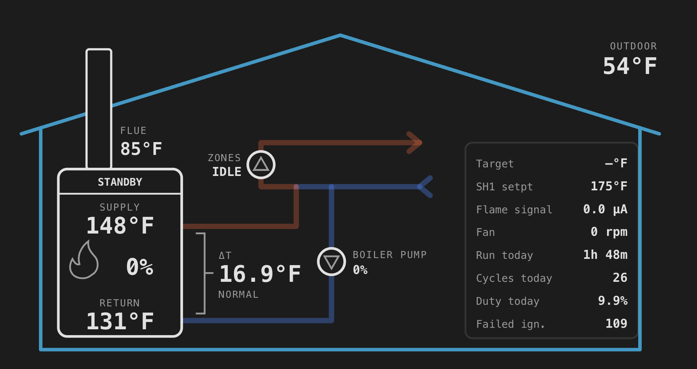

# Example Home Assistant dashboard

This folder has a full dashboard view for the boiler. At the top is a live diagram, laid out like
the boiler's own screen. The pipes animate while a pump runs, and the flame flickers while the
burner is lit. Below it are tiles, graphs and counters.

## Files

- [boiler-view.yaml](boiler-view.yaml): the dashboard view.
- [history-stats.yaml](history-stats.yaml): four sensors for run time, burns and duty cycle today
  (and run time this month). The diagram and the "Firing Today" cards use them.

## Set it up

1. Install **html-template-card** from HACS (search for "HTML Jinja2 Template card"). The diagram
   needs it. The rest of the view uses built-in cards.
2. Add the sensors in `history-stats.yaml` to your `configuration.yaml`. Restart Home Assistant.
3. Open a dashboard and click the pencil to edit it. Add a view, then open its menu and pick
   **Edit in YAML**. Paste in all of `boiler-view.yaml` and save.

## If your entity names are different

The example assumes the device is named **Lochinvar Boiler**. That is the Docker container's
default, and the name in [esphome/lochinvar.yaml](../../esphome/lochinvar.yaml). Its entities look
like `sensor.lochinvar_boiler_outlet_temperature`.

If you named the device something else, find and replace `lochinvar_boiler_` in both files. For
example, a device named "Boiler" uses `sensor.boiler_outlet_temperature`, so replace
`lochinvar_boiler_` with `boiler_`.

The colors come from your Home Assistant theme, so the diagram works in light and dark mode.
